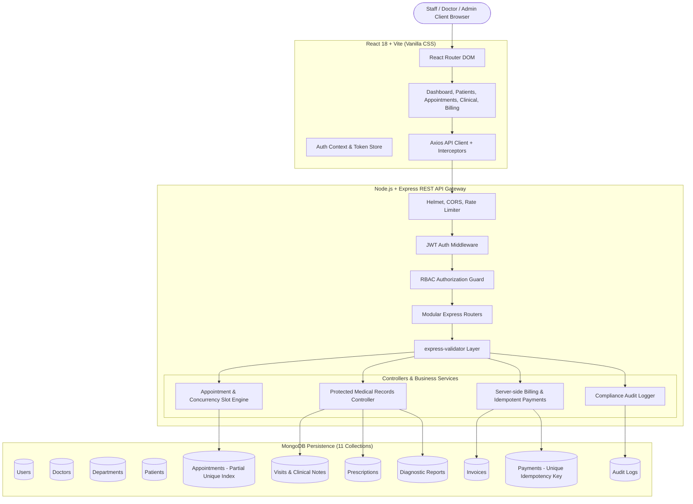

# MedPulse - Enterprise Hospital Management System
**Organization**: ALGIONS AI LABS PRIVATE LIMITED | Full-Stack Web Development Individual Assessment  
**Author**: Antigravity Senior Full-Stack Software Engineer & UI/UX Architect

[](https://nodejs.org/)
[](https://react.dev/)
[](https://www.mongodb.com/)
[](#technology-stack)
[](#automated-testing)
[](#api-documentation)

---

## 1. Project Overview

MedPulse is a complete, responsive, database-backed Hospital Management System designed to meet all functional, architectural, security, and UI/UX criteria of the **ALGIONS AI LABS** Full-Stack Web Development Assessment.

Every single module is fully connected to the backend API and MongoDB. The system features:
- **High-Integrity Concurrency & Double-Booking Prevention**: Database-level partial compound unique indexes and atomic server-side slot availability verification preventing scheduling collisions.
- **Strict Role-Based Access Control (RBAC)**: Multi-tiered backend authorization strictly isolating clinical records (`DOCTOR`), front desk operations (`FRONT_DESK`), and administrative governance (`ADMIN`).
- **Clinical Privacy Shield**: Doctors are cryptographically and contextually restricted to patients with whom they have active or completed encounters. Front Desk staff are blocked from reading clinical notes or altering prescriptions.
- **Financial Reconciliation & Idempotent Payments**: Dynamic server-side invoice calculations, simulated payments (Cash, Card, UPI), and idempotency keys to prevent duplicate payments.
- **Compliance Audit Logging**: Comprehensive, fail-safe audit logging recording every patient record access, scheduling change, and financial transaction.
- **Vanilla CSS Design System**: Built completely from scratch without Tailwind CSS, Bootstrap, Material UI, or utility-first frameworks.

---

## 2. Technology Stack

### Frontend
- **React 18** (Vite build engine)
- **React Router DOM v6** (declarative client-side routing & route guards)
- **Axios** (interceptors for JWT authentication and error standardization)
- **Pure Vanilla CSS** (CSS Variables, Flexbox, CSS Grid, component-specific stylesheets)
- **Lucide React** (modern healthcare iconography)

### Backend
- **Node.js & Express.js** (modular REST API)
- **MongoDB & Mongoose 8** (11 indexed schemas, validation, aggregation pipelines)
- **JWT (JSON Web Tokens)** & **bcryptjs** (password hashing & stateless auth)
- **Helmet**, **CORS**, and **express-rate-limit** (security baselines)
- **express-validator** (request sanitization and validation)
- **Swagger UI Express** (OpenAPI 3.0 interactive documentation)

### Testing
- **Jest 29** & **Supertest 7** (41 automated tests across 7 comprehensive suites)
- **MongoDB Memory Server** / Local MongoDB testing harness

---

## 3. System Architecture Diagram



---

## 4. Directory Structure

```
c:\Users\karan\OneDrive\Desktop\hos\
├── backend/
│   ├── config/             # Database connection, constants, environment
│   ├── controllers/        # Express handlers (Auth, Patient, Appt, Billing, etc.)
│   ├── middleware/         # Auth, RBAC, error handler, rate limiters
│   ├── models/             # 11 Mongoose schemas with validation and indexes
│   ├── routes/             # REST route endpoints
│   ├── services/           # Slot availability engine, invoice math, audit
│   ├── validators/         # Input validation rules (express-validator)
│   ├── utils/              # API response wrapper, JWT helper
│   ├── tests/              # 27 automated tests (Jest + Supertest)
│   ├── seeders/            # Repeatable database seeding script
│   ├── docs/               # OpenAPI Swagger 3.0 specification
│   ├── app.js              # Express app setup and middleware
│   ├── server.js           # Server listener bootstrap
│   └── package.json
├── frontend/
│   ├── src/
│   │   ├── components/     # Modal, Table, StatusBadge, StatsCard, EmptyState
│   │   ├── context/        # AuthContext, ToastContext
│   │   ├── layouts/        # DashboardLayout, Sidebar, Topbar
│   │   ├── pages/          # 9 complete, connected page views
│   │   ├── routes/         # ProtectedRoute guard
│   │   ├── services/       # Axios API client
│   │   ├── styles/         # Pure Vanilla CSS design tokens & stylesheets
│   │   ├── App.jsx         # Master router
│   │   └── main.jsx
│   ├── index.html
│   ├── vite.config.js
│   └── package.json
├── docs/
│   ├── ER_DIAGRAM.md       # Mermaid ER Diagram & comprehensive data dictionary
│   └── TECHNICAL_REPORT.md # Deep-dive engineering evaluation report
├── .env.example
├── .gitignore
├── package.json            # Root orchestration package
└── README.md
```

---

## 5. Demo Credentials

The database seeder provisions realistic hospital accounts with a common password:

| Role | Email Address | Password | Permissions & Workspace |
|---|---|---|---|
| **ADMIN** | `admin@hospital.demo` | `Hospital@123` | Full access: Staff, Departments, Billing, Audit Logs, Analytics |
| **DOCTOR** | `doctor@hospital.demo` | `Hospital@123` | Dr. Sarah Jenkins (Cardiology): Assigned Appointments, Clinical Charting, Prescriptions |
| **DOCTOR** | `doctor.neuro@hospital.demo` | `Hospital@123` | Dr. Robert Chen (Neurology): Clinical Workspace |
| **FRONT_DESK** | `reception@hospital.demo` | `Hospital@123` | James Miller: Patient Registration, Appointment Scheduling, Billing & Simulated Payments |

> **Pro-Tip**: The login page includes **1-Click Quick Demo Autofill** buttons for instant access to each role.

---

## 6. Installation & Quick Start Guide

### Prerequisites
- Node.js (v18 or higher; tested on v24.13.0)
- MongoDB (Local instance running on `mongodb://127.0.0.1:27017` or MongoDB Atlas URI)

If running locally on Windows with MongoDB installed:
```bash
npm run mongo
```

### Step 1: Clone or Navigate to Directory
```bash
cd c:\Users\karan\OneDrive\Desktop\hos
```

### Step 2: Environment Variable Setup
Ensure `backend/.env` exists (copied from `.env.example`):
```env
PORT=5000
NODE_ENV=development
MONGODB_URI=mongodb://127.0.0.1:27017/hospital_management
JWT_SECRET=super_secure_hospital_jwt_secret_key_2026_algions
JWT_EXPIRES_IN=24h
DEMO_PASSWORD=Hospital@123
CORS_ORIGIN=http://localhost:5173
```

### Step 3: Install Dependencies
```bash
# Install backend packages
npm --prefix backend install

# Install frontend packages
npm --prefix frontend install
```

### Step 4: Seed Database with Synthetic Hospital Data
```bash
npm run seed
```
*Creates 6 clinical departments, 4 staff demo accounts, 5 patients, realistic appointments, clinical notes, prescriptions, diagnostic lab reports, invoices, simulated payments, and compliance audit logs.*

### Step 5: Start the Application

**Terminal 1 (Backend REST API Server)**:
```bash
npm run backend
# Running on http://localhost:5000
# Swagger API Docs available at http://localhost:5000/api/docs
```

**Terminal 2 (Frontend Client)**:
```bash
npm run frontend
# Running on http://localhost:5173
```

---

## 7. Interactive API Documentation

Interactive Swagger / OpenAPI 3.0 documentation is integrated into the backend:
- **URL**: [http://localhost:5000/api/docs](http://localhost:5000/api/docs)
- Features schema definitions, example requests, response formats, parameter documentation, and JWT `BearerAuth` authorization headers.

---

## 8. Automated Testing

Run the automated test suite covering all critical business rules:
```bash
npm test
```

### Test Suite Coverage (41 / 41 Passing across 7 Suites):
1. **User Management & Account Creation (`tests/users.test.js`) - NEW**:
   - Admin successfully creates users across `ADMIN`, `DOCTOR`, and `FRONT_DESK` roles.
   - Duplicate email registration rejected with HTTP 409 Conflict.
   - Password hashing verification (bcrypt hash in database, raw passwords never stored).
   - **Doctor account linking**: seamlessly links user account to an existing unlinked Doctor profile; prevents duplicate linking to another user (HTTP 409).
   - **RBAC Enforcements**: non-admin staff (`DOCTOR`, `FRONT_DESK`) receive HTTP 403 Forbidden; unauthenticated callers receive HTTP 401 Unauthorized.
   - **Privacy & sanitization**: `passwordHash` strictly omitted from all API responses (POST, GET, PUT).
   - **Account status toggling**: active/inactive toggling with automatic login rejection for deactivated users.
   - **Last Active Admin Protection**: guards prevent deactivating or demoting the last remaining active administrator (HTTP 400).
   - Aggregated user counts and multi-field search and pagination.
2. **Authentication API (`tests/auth.test.js`)**:
   - Valid credentials return JWT token and omit password hashes.
   - Invalid password and non-existent email rejection.
   - Protected routes rejection with missing or malformed tokens.
   - Current user profile retrieval and password changes.
3. **Patient Management (`tests/patient.test.js`)**:
   - Safe registration with auto-generated `PAT-YYYY-XXXX` identifiers.
   - Schema input validation and rejection of invalid payloads.
   - Patient search with pagination.
   - Safe administrative record deactivation.
4. **Appointment Scheduling & Concurrency (`tests/appointments.test.js`)**:
   - Dynamic schedule slot generation.
   - **Double-booking prevention**: overlapping requests for the same doctor slot return HTTP 409 Conflict.
   - **Simultaneous concurrent booking**: race-condition protection guarantees exactly one winner.
   - **Slot re-availability**: cancelling an appointment immediately frees the slot for another patient.
   - Invalid rescheduling validation.
5. **Role-Based Authorization & Privacy (`tests/authorization.test.js`)**:
   - **Doctor privacy restriction**: physician accessing an unassigned patient receives HTTP 403 Forbidden.
   - **Front Desk privacy guard**: front desk attempting to read clinical notes or write prescriptions receives HTTP 403 Forbidden.
   - Front Desk blocked from audit logs (HTTP 403).
   - Admin access to administrative reports and audit logs.
6. **Billing & Payments (`tests/billing.test.js`)**:
   - Server-side verification of item totals, subtotal, tax, discount, and final amount.
   - Payment status progression (`PENDING` -> `PARTIALLY_PAID` -> `PAID`).
   - **Idempotency protection**: duplicate `transactionReference` submissions return HTTP 409.
7. **Compliance Audit Trail (`tests/audit.test.js`)**:
   - Patient creation and record access trigger audit entries.
   - Administrator search and filtering of audit logs.

---

## 9. Key Modules Overview

- **Module 1: Dashboard**: Real-time aggregated statistics (Patients, Doctors, Appointments, Revenue, Pending Balances), CSS volume trends, encounter status distribution, recent appointments, and live audit feed. Doctor role displays personalized daily patient queue.
- **Module 2: Patient Management**: Demographics, emergency contacts, allergy warnings, medical record numbers, multi-field search, pagination, and patient charts.
- **Module 3: Doctors & Departments**: Staff directory, department assignment, fee schedules, weekly clinic hours modal, and availability toggle.
- **Module 4: Appointment Management**: 9-step booking wizard with live slot generation, server-side slot availability check, atomic double-booking guard, slot rescheduling, and cancellation.
- **Module 5: Clinical Workspace (Doctor)**: Consultation notes, patient-reported symptoms, blood pressure, pulse, temperature, follow-up dates, diagnostic test requests, and itemized prescriptions.
- **Module 6: Billing & Invoicing**: Itemized invoices, tax and discount computation, invoice receipt modal, and simulated payments (Cash, Card, UPI) with idempotency reconciliation.
- **Module 7: Reports & Compliance Audit**: Daily, doctor-wise, and department-wise appointment aggregation, financial revenue breakdown, pending invoice aging, and immutable audit logs.
- **Module 8: User Management & Governance (Admin)**: Complete user lifecycle management for hospital staff:
  - Aggregated KPIs: Total users, Active users, Inactive users, Admins, Doctors, Front Desk staff.
  - User Directory: Search by name and email, role filtering, account status filtering, and pagination.
  - "Add New User" modal with client & server-side validation, password confirmation, role assignment, and active status flag.
  - **Doctor Profile Linking**: Intelligently searches and links the user account to existing unlinked Doctor profiles, ensuring that logging in as that doctor immediately opens the Doctor Dashboard and clinical records.
  - Edit User modal with optional password updating and doctor re-linking.
  - Safe deactivation toggle with Last Active Admin Protection.
  - Restricted login guidance: "New staff member? Contact your hospital administrator to get an account." preventing unrestricted public signups.

---

## 10. Architectural Documentation Links

- Detailed ER Diagram & Data Dictionary: [docs/ER_DIAGRAM.md](docs/ER_DIAGRAM.md)
- Complete Technical & Engineering Report: [docs/TECHNICAL_REPORT.md](docs/TECHNICAL_REPORT.md)
- Master Development Plan: [docs/MASTER_PLAN.md](docs/MASTER_PLAN.md)

