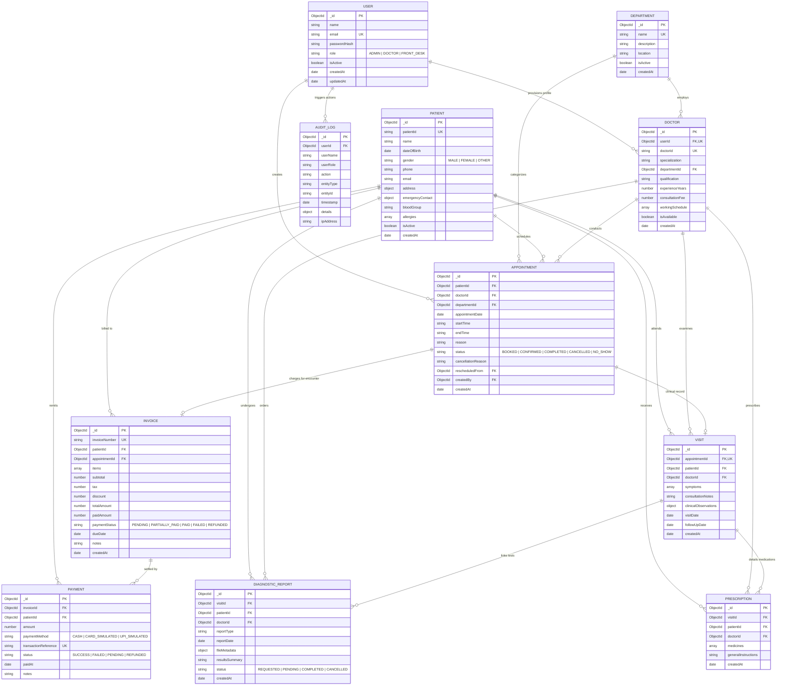

# Hospital Management System - Entity Relationship Diagram & Data Dictionary
**Organization**: ALGIONS AI LABS PRIVATE LIMITED | Full-Stack Web Development Assessment  
**Author**: Antigravity Full-Stack Engineering Team

---

## 1. Mermaid Entity-Relationship (ER) Diagram



---

## 2. Comprehensive Data Dictionary & Schema Constraints

### 1. `User` Collection
| Field | Type | Required | Constraints / Default | Description |
|---|---|---|---|---|
| `_id` | ObjectId | Yes | Primary Key | MongoDB Unique Document Identifier |
| `name` | String | Yes | Trimmed, max 100 chars | Full name of staff member |
| `email` | String | Yes | Unique index, lowercase, regex validated | Account email address |
| `passwordHash` | String | Yes | Excluded from queries by default (`select: false`) | bcrypt hashed credential (salt rounds: 10) |
| `role` | String | Yes | Enum: `['ADMIN', 'DOCTOR', 'FRONT_DESK']`, default: `FRONT_DESK` | Role-based authorization tier |
| `isActive` | Boolean | Yes | Default: `true` | Account activation flag |

### 2. `Department` Collection
| Field | Type | Required | Constraints / Default | Description |
|---|---|---|---|---|
| `_id` | ObjectId | Yes | Primary Key | MongoDB Identifier |
| `name` | String | Yes | Unique index, trimmed | Department name (e.g., Cardiology, Neurology) |
| `description` | String | No | Trimmed, max 500 chars | Clinical description & capabilities |
| `location` | String | Yes | Trimmed | Building wing and floor location |
| `isActive` | Boolean | Yes | Default: `true` | Operating status |

### 3. `Doctor` Collection
| Field | Type | Required | Constraints / Default | Description |
|---|---|---|---|---|
| `_id` | ObjectId | Yes | Primary Key | MongoDB Identifier |
| `userId` | ObjectId | Yes | Unique index, Ref: `User` | Link to user credentials |
| `doctorId` | String | Yes | Unique index, uppercase | Hospital staff ID (e.g., `DOC-1001`) |
| `specialization` | String | Yes | Trimmed | Clinical specialty |
| `departmentId` | ObjectId | Yes | Ref: `Department` | Assigned clinical department |
| `qualification` | String | Yes | Trimmed | Medical degrees & board certifications |
| `experienceYears`| Number | Yes | Min: 0, default: 1 | Years of clinical practice |
| `consultationFee`| Number | Yes | Min: 0 | OPD consultation charge in USD |
| `workingSchedule`| Array | Yes | Embedded subdocuments | Day-wise clinic hours & slot durations |
| `isAvailable` | Boolean | Yes | Default: `true` | Booking availability toggle |

### 4. `Patient` Collection
| Field | Type | Required | Constraints / Default | Description |
|---|---|---|---|---|
| `_id` | ObjectId | Yes | Primary Key | MongoDB Identifier |
| `patientId` | String | Yes | Unique index, uppercase | Permanent Medical Record Number (`PAT-YYYY-XXXX`) |
| `name` | String | Yes | Trimmed, max 120 chars | Full legal name |
| `dateOfBirth` | Date | Yes | ISO8601 Date | Date of birth |
| `gender` | String | Yes | Enum: `['MALE', 'FEMALE', 'OTHER']` | Biological gender |
| `phone` | String | Yes | Trimmed, indexed | Primary contact phone |
| `email` | String | No | Trimmed, lowercase | Optional email address |
| `address` | Object | No | `{ street, city, state, postalCode }` | Residential address |
| `emergencyContact`| Object | No | `{ name, relationship, phone }` | Emergency next-of-kin |
| `bloodGroup` | String | No | Enum: `['A+', 'A-', 'B+', 'B-', 'AB+', 'AB-', 'O+', 'O-', 'UNKNOWN']` | ABO / Rh blood type |
| `allergies` | Array | No | Array of strings | Known drug or substance allergies |
| `isActive` | Boolean | Yes | Default: `true` | Soft-deletion flag |

### 5. `Appointment` Collection
| Field | Type | Required | Constraints / Default | Description |
|---|---|---|---|---|
| `_id` | ObjectId | Yes | Primary Key | MongoDB Identifier |
| `patientId` | ObjectId | Yes | Ref: `Patient` | Patient reference |
| `doctorId` | ObjectId | Yes | Ref: `Doctor` | Assigned physician |
| `departmentId` | ObjectId | Yes | Ref: `Department` | Clinical specialty |
| `appointmentDate`| Date | Yes | Indexed | Start-of-day UTC timestamp |
| `startTime` | String | Yes | Regex: `^([01]\d\|2[0-3]):([0-5]\d)$` | Slot start time (`HH:mm`) |
| `endTime` | String | Yes | Regex: `^([01]\d\|2[0-3]):([0-5]\d)$` | Slot end time (`HH:mm`) |
| `reason` | String | Yes | Trimmed, max 500 chars | Chief complaint / purpose of visit |
| `status` | String | Yes | Enum: `['BOOKED', 'CONFIRMED', 'COMPLETED', 'CANCELLED', 'NO_SHOW']` | Encounter status lifecycle |
| `cancellationReason` | String | No | Trimmed | Reason for cancellation if applicable |
| `rescheduledFrom` | ObjectId | No | Ref: `Appointment` | Link to previous appointment slot |
| `createdBy` | ObjectId | Yes | Ref: `User` | User who booked appointment |

**Compound Index for Atomic Concurrency & Anti-Double-Booking**:
```javascript
appointmentSchema.index(
  { doctorId: 1, appointmentDate: 1, startTime: 1 },
  {
    unique: true,
    partialFilterExpression: {
      status: { $in: ['BOOKED', 'CONFIRMED'] }
    }
  }
);
```

### 6. `Visit` Collection
| Field | Type | Required | Constraints / Default | Description |
|---|---|---|---|---|
| `_id` | ObjectId | Yes | Primary Key | MongoDB Identifier |
| `appointmentId` | ObjectId | Yes | Unique index, Ref: `Appointment` | Linked clinical encounter |
| `patientId` | ObjectId | Yes | Ref: `Patient` | Patient reference |
| `doctorId` | ObjectId | Yes | Ref: `Doctor` | Examining doctor |
| `symptoms` | Array | No | Array of strings | Patient-reported clinical symptoms |
| `consultationNotes` | String | Yes | Trimmed | Physician examination & clinical notes |
| `clinicalObservations` | Object | No | `{ bloodPressure, pulseRate, temperatureF, weightKg }` | Vitals documented at triage |
| `visitDate` | Date | Yes | Default: `Date.now` | Encounter timestamp |
| `followUpDate` | Date | No | Default: `null` | Recommended next clinical encounter |

### 7. `Prescription` Collection
| Field | Type | Required | Constraints / Default | Description |
|---|---|---|---|---|
| `_id` | ObjectId | Yes | Primary Key | MongoDB Identifier |
| `visitId` | ObjectId | Yes | Ref: `Visit` | Clinical consultation reference |
| `patientId` | ObjectId | Yes | Ref: `Patient` | Patient recipient |
| `doctorId` | ObjectId | Yes | Ref: `Doctor` | Prescribing physician |
| `medicines` | Array | Yes | Non-empty array of `{ name, dosage, frequency, duration, instructions }` | Itemized medications |
| `generalInstructions`| String | No | Trimmed | Dietary and pharmacological guidelines |

### 8. `DiagnosticReport` Collection
| Field | Type | Required | Constraints / Default | Description |
|---|---|---|---|---|
| `_id` | ObjectId | Yes | Primary Key | MongoDB Identifier |
| `visitId` | ObjectId | No | Ref: `Visit` | Optional visit encounter link |
| `patientId` | ObjectId | Yes | Ref: `Patient` | Patient reference |
| `doctorId` | ObjectId | No | Ref: `Doctor` | Requesting physician |
| `reportType` | String | Yes | Trimmed | Test name (e.g., ECG, CBC, CMP) |
| `reportDate` | Date | Yes | Default: `Date.now` | Date of report issuance |
| `fileMetadata` | Object | No | `{ fileName, fileType, fileSizeKb, url }` | Document storage metadata |
| `resultsSummary` | String | No | Trimmed | Clinical findings summary |
| `status` | String | Yes | Enum: `['REQUESTED', 'PENDING', 'COMPLETED', 'CANCELLED']` | Processing state |

### 9. `Invoice` Collection
| Field | Type | Required | Constraints / Default | Description |
|---|---|---|---|---|
| `_id` | ObjectId | Yes | Primary Key | MongoDB Identifier |
| `invoiceNumber` | String | Yes | Unique index, uppercase | Financial invoice number (`INV-YYYY-XXXX`) |
| `patientId` | ObjectId | Yes | Ref: `Patient` | Billed patient |
| `appointmentId` | ObjectId | No | Ref: `Appointment` | Associated encounter |
| `items` | Array | Yes | Array of `{ description, quantity, unitPrice, total }` | Itemized billed services |
| `subtotal` | Number | Yes | Verified on backend, min: 0 | Sum of line items |
| `tax` | Number | Yes | Verified on backend, min: 0 | Computed sales/facility tax |
| `discount` | Number | Yes | Verified on backend, min: 0 | Approved concession |
| `totalAmount` | Number | Yes | Verified on backend: `subtotal + tax - discount` | Final balance due |
| `paidAmount` | Number | Yes | Default: 0 | Cumulative payments received |
| `paymentStatus` | String | Yes | Enum: `['PENDING', 'PARTIALLY_PAID', 'PAID', 'FAILED', 'REFUNDED']` | Invoice status |
| `dueDate` | Date | Yes | Default: `+7 days` | Payment due date |

### 10. `Payment` Collection
| Field | Type | Required | Constraints / Default | Description |
|---|---|---|---|---|
| `_id` | ObjectId | Yes | Primary Key | MongoDB Identifier |
| `invoiceId` | ObjectId | Yes | Ref: `Invoice` | Target invoice |
| `patientId` | ObjectId | Yes | Ref: `Patient` | Patient payee |
| `amount` | Number | Yes | Min: 0.01 | Amount paid in USD |
| `paymentMethod` | String | Yes | Enum: `['CASH', 'CARD_SIMULATED', 'UPI_SIMULATED']` | Simulated payment channel |
| `transactionReference`| String | Yes | Unique index, trimmed | Idempotency key preventing double payments |
| `status` | String | Yes | Enum: `['SUCCESS', 'FAILED', 'PENDING', 'REFUNDED']` | Transaction outcome |
| `paidAt` | Date | Yes | Default: `Date.now` | Payment timestamp |

### 11. `AuditLog` Collection
| Field | Type | Required | Constraints / Default | Description |
|---|---|---|---|---|
| `_id` | ObjectId | Yes | Primary Key | MongoDB Identifier |
| `userId` | ObjectId | No | Ref: `User` | Operator identifier (null for system) |
| `userName` | String | Yes | Default: `'System'` | Operator readable name |
| `userRole` | String | Yes | Default: `'SYSTEM'` | Operator role at time of action |
| `action` | String | Yes | Indexed | Audit action code (e.g. `PATIENT_CREATE`) |
| `entityType` | String | Yes | Indexed | Affected collection (e.g., `Patient`, `Appointment`) |
| `entityId` | String | Yes | Indexed | Document identifier |
| `timestamp` | Date | Yes | Indexed, default: `Date.now` | Exact event timestamp |
| `details` | Mixed | No | Object | Operational payload & change metadata |
| `ipAddress` | String | No | Client IP address | Source IP for regulatory compliance |

